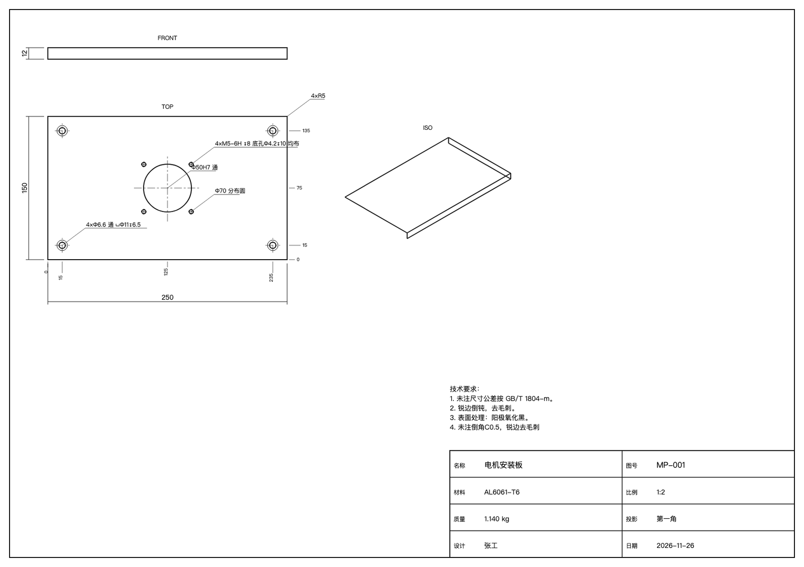
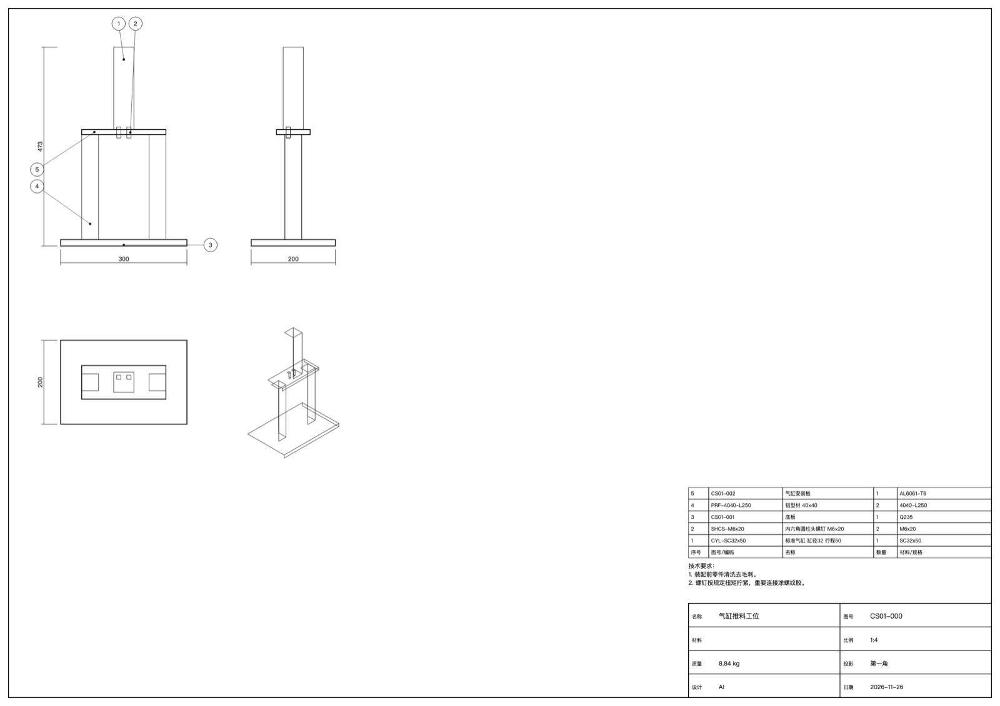
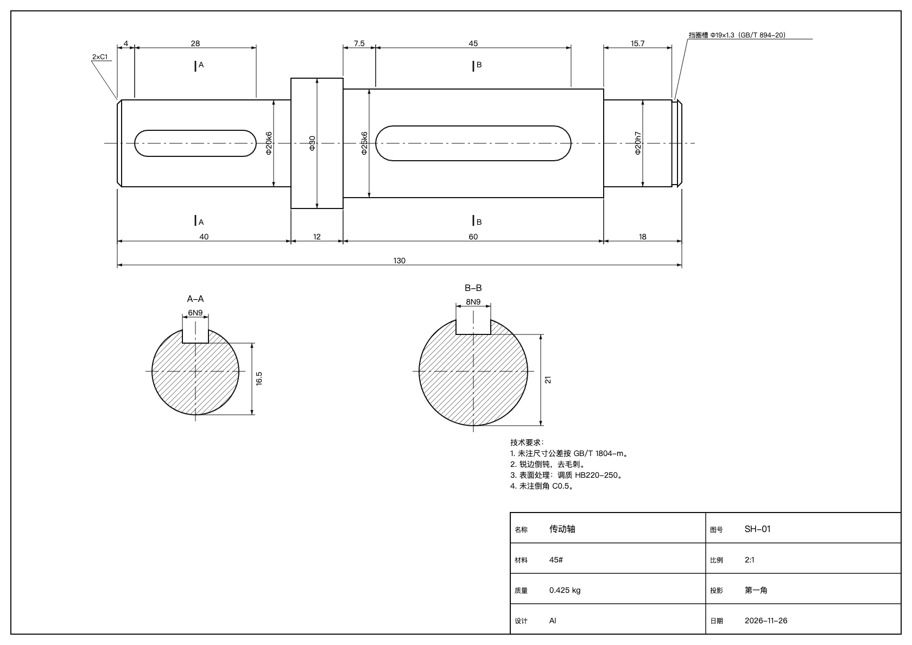

# cad-mcp

**让 Claude Code / Codex 通过 MCP 驱动 SolidWorks 与 Creo 完成机械建模和出图。**

AI 不再一步步"点 CAD"：它写一份与 CAD 无关的**设计规格（spec）**，平台负责标准查表、规则检查、出图规划，再编译成 SolidWorks / Creo 的原生模型与工程图。目标是替代非标自动化设备中工程师的日常画图工作，工程师只做审核。

<p align="center">
  
  
</p>
<p align="center">
  
</p>
<p align="center"><sub>上左：Claude Code 根据一句中文需求生成的零件图（模拟 CAD 预览）；上右：示例装配图，含明细表与序号；下：轴类零件图，键槽按 GB/T 1095 查表并自动出断面图</sub></p>

> **项目状态：早期（v0.2）**。平台核心已在模拟 CAD 上完整跑通；**SolidWorks COM 执行器与 Creo 适配器已编写、尚未实机验证**。详见 [实现状态](docs/DESIGN.md#16-实现状态2026-11-26)。

## 工作原理

```
需求 ──AI──► spec（JSON：参数、基体、孔、型腔、基准、装配、出图要求）
               │
               ├─ IR 解析       参数表达式求值、螺纹/沉孔标准展开、质量估算
               ├─ 设计规则       孔边距、破边、盲孔深度、螺纹深度、孔距、钣金折弯边距…
               ├─ 出图规划       图幅比例、GB 第一角布局、坐标尺寸、孔标注、技术要求、标题栏、明细表
               │
               └─ 适配器编译 ──► SolidWorks（COM）/ Creo（CREOSON）/ Mock（任意平台）
                                   └─ 回读再生错误、实测质量 → 与 spec 对账
```

- **一份 spec，两种 CAD**：同一描述编译到 SolidWorks 或 Creo。
- **参数化与关联更新**：改一个参数，零件、引用它的装配和图纸自动重建。
- **不破坏原始数据**：所有修改在隔离工作区进行，支持检查点与回滚；发布版本不可覆盖；新版本 CAD 默认只读打开旧版本文件。
- **多版本共存**：SolidWorks 2022/2024/2026 用带版本号的 ProgID 精确连接，Creo 7/9/10 各配独立 CREOSON。

## 快速开始（任意平台，模拟 CAD）

需要 [uv](https://docs.astral.sh/uv/)。

```bash
git clone https://github.com/hongheshan-svg/cad-mcp.git
cd cad-mcp
uv sync
uv run pytest -q          # 全部通过
uv run cadmcp doctor      # 查看可用目标（默认两个模拟目标：mock-sw2024、mock-creo10）
```

在仓库目录启动 Claude Code，项目自带的 `.mcp.json` 会提示启用 `cad` 服务器，然后试试：

```
用 cad MCP 设计一块电机安装板，材料 AL6061-T6，外形 250×150，厚 12，四角 R5。
中心 Φ50H7 止口通孔；周围 4×M5 螺纹孔（深10，螺纹深8）均布在 Φ70 圆上，起始角45°；
四角 4×M6 内六角沉孔，孔中心距边 15。图号 MP-001，表面处理 阳极氧化黑。出图并提交版本 A。
```

工程图 SVG 预览和发布文件会出现在 `~/cadmcp/` 下（可用 `CADMCP_WORKSPACE` 修改）。

### 接入 Codex

```toml
# ~/.codex/config.toml
[mcp_servers.cad]
command = "uv"
args = ["run", "--project", "/path/to/cad-mcp", "cadmcp", "serve", "--stdio"]
tool_timeout_sec = 300
```

也支持 Streamable HTTP：`uv run cadmcp serve --http 0.0.0.0:8765`。

## 连接真实 CAD（Windows）

```powershell
git clone https://github.com/hongheshan-svg/cad-mcp.git D:\cad-mcp
cd D:\cad-mcp
powershell -ExecutionPolicy Bypass -File scripts\win\setup.ps1
uv run python scripts\win\probe_sw.py --version 2024 --node-config D:\cadmcp\node.yaml
```

节点配置示例见 [`config/node.windows.example.yaml`](config/node.windows.example.yaml)，完整步骤与核对清单见 **[docs/WINDOWS_TEST.md](docs/WINDOWS_TEST.md)**。

## spec 示例

```json
{
  "name": "CS01-002_CylMountPlate", "part_no": "CS01-002", "title": "气缸安装板",
  "material": "AL6061-T6", "surface_treatment": "阳极氧化黑",
  "parameters": {"L": 200, "W": 80, "T": 12, "pitch": 160},
  "base": {"type": "extrude", "profile": {"shape": "rect", "width": "L", "height": "W"}, "thickness": "T"},
  "features": [
    {"feature": "hole", "name": "Post", "type": "counterbore", "size": "M8",
     "positions": [["-pitch/2", 0], ["pitch/2", 0]]},
    {"feature": "hole", "name": "Cyl", "type": "clearance", "size": "M6",
     "pattern": {"kind": "circular", "radius": 17, "count": 4, "start_angle": 45}},
    {"feature": "hole", "name": "Rod", "type": "simple", "size": 26, "positions": [[0, 0]]}
  ],
  "references": [{"name": "CS_Cyl", "origin": [0, 0, "T"]}]
}
```

孔只需写类型和公制规格，底孔、过孔、沉孔尺寸由平台按标准查表；与外购件对接的孔用 `mount` 特征按库登记的接口自动生成，装配时还会校验装的是不是同一个件；装配只按命名坐标系（`CS_*`）定位，不选面、不选边。完整示例见 [`examples/cylinder_station.py`](examples/cylinder_station.py)。

## MCP 工具

| 分组 | 工具 |
|------|------|
| 目标 | `cad_list_targets` `cad_select_target` `cad_get_capabilities` |
| 变更会话 | `cad_change_begin` `cad_change_status` `cad_checkpoint` `cad_change_rollback` `cad_change_commit` |
| 建模 | `cad_build_part` `cad_build_assembly` `cad_build_drawing` `cad_set_parameters` |
| 读取 | `cad_get_model` `cad_search_library` `cad_open_existing` |
| 选型计算 | `cad_calc`（气缸、伺服+丝杠、同步带、螺栓组，输出计算书） |
| 校验与输出 | `cad_validate` `cad_check_interference` `cad_export_bom` `cad_export` |

每个工具都带只读/写入注解，便于客户端审批；出错时返回的 `error.hint` 是写给 AI 看的下一步建议。出图工作流见 [`skills/mechanical-drawing/SKILL.md`](skills/mechanical-drawing/SKILL.md)。

## 能力边界

| 支持 | 暂不支持 |
|------|---------|
| 板/块/L 形件（外形、螺纹孔/过孔/沉孔/销孔/腰型孔、型腔、凸台、倒角圆角，含内侧面特征） | 斜孔、螺纹轴端 |
| 阶梯轴（键槽、挡圈槽、退刀槽、端部倒角、配合公差，自动出断面图） | 焊接件、铸件 |
| 简单钣金（直边折弯、展开尺寸） | 复杂曲面 |
| 标准件/外购件装配、BOM | Creo 从零建模（需 UDF 库或 TOOLKIT 授权） |
| 基准、几何公差、表面粗糙度（含配合面粗糙度检查） | SolidWorks 原生公差框格（当前以注释输出） |

## 目录

```
src/cadmcp/
  ir/            spec 模型与解析          rules.py      设计规则
  detailing.py   出图规划与检查           render_svg.py 工程图预览
  adapters/      mock / solidworks / creo gateway/      会话、策略、MCP 服务
docs/            DESIGN.md（架构设计）  WINDOWS_TEST.md（实机测试手册）
scripts/win/     Windows 安装与探针脚本  skills/      AI 出图工作流
```

## 文档

- [架构设计](docs/DESIGN.md)：多版本共存、统一接口、文件安全、适配器实现要点、分阶段计划
- [Windows 实机测试手册](docs/WINDOWS_TEST.md)

## 许可证

[Apache-2.0](LICENSE)
